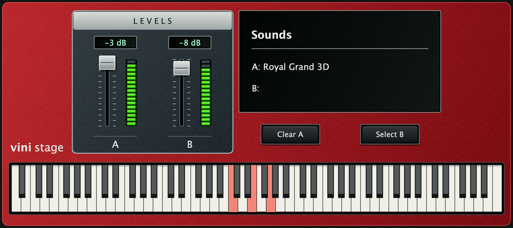

# Vini Stage

VST3 e aplicativo standalone para carregar timbres Nord `.npno` diretamente e tocar por MIDI. Dois timbres opcionais A/B, controles simples e teclado visual de 88 teclas. Compatível com **Intel/High Sierra 10.13** e **Apple Silicon/M4**.



**[Baixar Vini Stage 0.6.4 Universal.pkg — versão de teste](https://github.com/viniciiusds/Vini-Stage/releases/download/v0.6.4/Vini-Stage-0.6.4-Universal.pkg)** · [Todas as versões](https://github.com/viniciiusds/Vini-Stage/releases)

## Versão 0.6.4 — novo ícone com teclas de piano

Novo ícone: **VS** menor na parte superior e teclado compacto abaixo, com o mesmo fundo vermelho do plugin. Mantém o ICNS corrigido e a validação dos pixels nos tamanhos padrão e Retina.


O standalone recebe um ícone vermelho com as letras brancas **VS** e teclas de piano, usando o mesmo degradê do painel do plugin. O ícone inclui tamanhos próprios para Finder e Dock. Fontes do desenho em [assets/ViniStage.svg](assets/ViniStage.svg).

**String Res permanece adiado**, registrado no [backlog](docs/BACKLOG.md). O motor de áudio e o layout permanecem os da versão anterior.

## Instalador 0.6.1 — escolha os componentes

Na etapa **Tipo de instalação**, há duas opções independentes, inicialmente marcadas:

- **VST3** — instala ou atualiza `/Library/Audio/Plug-Ins/VST3/Vini Stage.vst3`.
- **Standalone** — instala ou atualiza `/Applications/Vini Stage.app`, para tocar sem abrir o Ableton.

Você pode selecionar uma ou ambas. Um componente desmarcado não é removido nem atualizado. Cada componente possui registro e verificação de versão próprios. Documentação e licenças são compartilhadas. A versão 0.6.1 mantém o motor de áudio da 0.6.0.

## Mudanças de áudio e carregamento — 0.6.0

Implementação própria orientada pela análise estática do caminho de piano do Sharp Stage Pianos. A comparação auditiva com o Sharp ativado no High Sierra ainda é necessária; não há promessa de som idêntico.

- **Velocity neutra na entrada:** removido o Drive −0,50 embutido. A seleção de camadas usa uma coordenada calibrada, respeita fronteiras gravadas no arquivo e calcula fronteiras apenas quando ausentes. O ganho da voz tem uma curva separada, com interpolação em dB.
- **Ganho por sample e nota:** aplica trim com unidades validadas, correção por tecla e normalização de fallback. Remove o fator global fixo de 0,65 da versão anterior; não aplica um aumento arbitrário de saída.
- **Release ligado à amplitude recente:** um seguidor com constante de 50 ms acompanha a nota. Ao abafar, o sample de release usa esse estado e a normalização da gravação. Substitui o antigo teto de 2% multiplicado pela velocity inicial; notas já decaídas produzem releases mais discretos.
- **Soltura exponencial:** substitui os 90 ms lineares. Usa referência de 500 ms ajustada pelos metadados do sample; o tempo corresponde a uma queda de −80 dB. Respeita sustain e notas sem abafador.
- **Caudas e brilho:** taxas distintas antes/depois do loop, metadados de envelope, estimativa de decaimento quando faltam e filtro por voz de um polo no caminho de piano.
- **PCM de 16 bits:** preserva a precisão do áudio decodificado e reduz à metade o buffer final comparado aos floats de 32 bits anteriores. Royal Grand 3D XL 6.1: de 1.524.124.752 para 762.062.376 bytes de PCM.
- **Bibliotecas compartilhadas:** A/B e instâncias do mesmo módulo reutilizam um timbre ainda vivo com mesmo caminho, tamanho e data. Decodificações concorrentes do mesmo arquivo são unificadas. O cache mantém até 128 MiB adicionais de timbres ociosos; XLs maiores não ficam retidos após a última referência desaparecer.
- **Cancelamento cooperativo:** leitura e preparação verificam cancelamento; a decodificação em curso termina a gravação atual antes de interromper. Evita terminar um piano inteiro antes de atender Clear ou uma seleção mais recente.

No M4, a primeira carga medida sem cache de áudio do plugin ficou em aproximadamente **1,9 s**, próxima da versão anterior (~2 s). O principal ganho confirmado é memória e reutilização de bibliotecas. Os tempos no MacBook de 2011 ainda precisam ser medidos. [Detalhes técnicos, medições e limites](docs/ENGINE-0.6.0.md).

**Para comparar o som:** comece com o efeito Velocity do Ableton neutro, sem curvas compensatórias usadas nas versões antigas. Alinhe os níveis de saída e desligue efeitos. O Vini mantém os faders A/B com máximo de 0 dB; não possui o master independente do Sharp, cujo valor padrão observado era −6 dB. Equalize essa diferença ao comparar volume.

## Instalar e tocar

1. Feche o Ableton e o Vini Stage standalone e abra o `.pkg`.
2. Marque **VST3**, **Standalone** ou ambos. O plugin vai para a pasta global de VST3 e o aplicativo para `/Applications/`. Informe a senha de administrador quando o instalador solicitar.
3. Para o standalone, abra **Aplicativos → Vini Stage**. Para o VST3 no Live 11, habilite **Use VST3 Plug-In System Folders**, faça Rescan se necessário e abra **VST3 → Vinizera → Vini Stage** em uma pista MIDI.
4. Clique em **Select A** ou **Select B**, escolha um `.npno` e aguarde **Loading... X%**. Só um timbre é suficiente.
5. Para remover, clique em **Clear A/B**. Para trocar, remova e selecione outro arquivo.

O mesmo PKG contém **x86_64 com mínimo macOS 10.13** e **arm64 com mínimo 11.0**. Cada componente selecionado atualiza sua versão anterior no destino fixo. A instalação do VST3 substitui versões anteriores no destino global. Uma cópia igual ou mais antiga da pasta VST3 do usuário é guardada em `~/Library/Application Support/Vini Stage/Plugin Backups/` para evitar duplicidade; versões mais novas e plugins com outra identidade são preservados. Timbres e projetos não são alterados.

O PKG é de teste, sem assinatura Developer ID Installer e sem notarização Apple. Builds anteriores foram confirmados pelo usuário no High Sierra com Arturia; a nova versão ainda requer audição naquele Mac. O PKG contém VST3 e standalone selecionáveis, sem bibliotecas de timbres.

## Controles e projetos

- Visor Sounds único com linhas A/B. Linha vazia mostra apenas `A:` ou `B:`. Sem botões ON/OFF visíveis.
- Faders de −60 a 0 dB em passos de 1 dB, mais −∞. Arraste atualiza o áudio, LEDs e visor durante o movimento; duplo clique retorna a 0 dB. O visor permite digitar o valor.
- LEDs mostram o volume configurado; não são medidores de áudio.
- 88 teclas A0–C8 clicáveis e com destaque MIDI. Sustain CC64 e 128 vozes por seção, compartilhadas entre notas e releases.
- Os caminhos A/B e os volumes são salvos no projeto. Ao reabrir, os arquivos são recarregados. Mantenha os `.npno` no mesmo caminho: o áudio não é embutido no projeto.
- Parâmetros ON/OFF antigos permanecem no host para compatibilidade com automação e projetos anteriores. Selecionar um timbre reativa sua seção.

## Compilar e verificar

Requer Rust/rustup com targets `x86_64-apple-darwin` e `aarch64-apple-darwin`, CMake, Xcode Command Line Tools e JUCE 8.0.12. A dependência `nord-format` está fixada em 0.8.0.

```bash
bash build.sh
```

O build instala o VST3 assinado ad-hoc em `~/Library/Audio/Plug-Ins/VST3/`. O standalone é gerado em `build/NpnoPlayer_artefacts/Release/Standalone/Vini Stage.app`. O pacote instala no destino global descrito acima.

```bash
bash package.sh
python3 packaging/test_package.py dist/Vini-Stage-0.6.4-Universal.pkg
```

Os testes de pacote usam diretórios temporários e não executam instalação real. Para Developer ID Installer, `package.sh` aceita `INSTALLER_SIGN_IDENTITY`; notarização exige um fluxo adicional.

A validação desta versão inclui unidades de metadados, cancelamento e cache concorrente, seleção de camadas do Royal, ganho por tecla, sustain de 14 s em 44,1/48 kHz, release por amplitude/duração, envelope exponencial isolado, duas camadas/estado/volume, editor e pacote Universal. Arquivos `.npno`, WAVs de audição, binários e pseudocódigo do Sharp não fazem parte deste repositório.

[Guia de uso](docs/USO.md) · [Notas do motor 0.6.0](docs/ENGINE-0.6.0.md)
