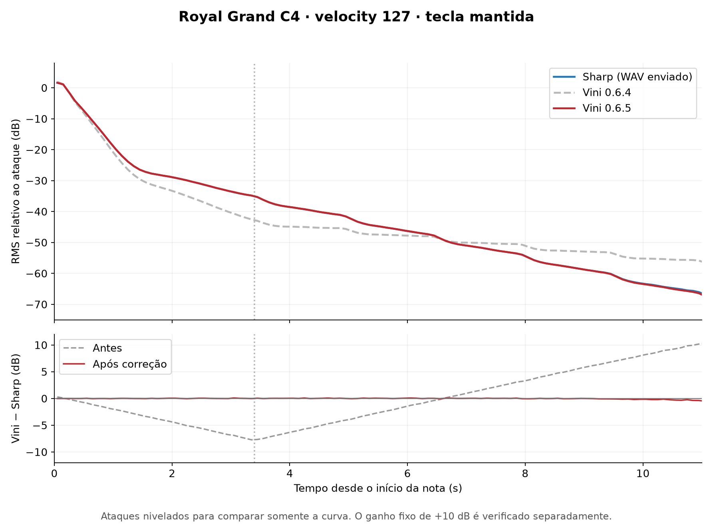

# Decaimento e ganho — 0.6.5

A comparação dos WAVs do Royal Grand enviados pelo usuário confirmou que as fases de decaimento estavam invertidas. O Vini perdia corpo mais cedo e mantinha uma cauda mais fraca por mais tempo. A versão 0.6.5 corrige essa associação e acrescenta o aumento de saída de 10 dB solicitado.

## Correção

Os nomes legados do bridge são preservados para evitar alteração de layout entre Rust e C++. `loop_decay` (registro 0x3a) fornece o coeficiente **antes do loop**, ajustado pela velocidade de leitura/transposição. `attack_decay` (registro 0x2e) fornece o coeficiente **dentro do loop**, ajustado pela razão entre taxa do áudio de origem e taxa do host. As vozes agora usam nomes explícitos `preLoopDecay` e `postLoopDecay`.

No Royal C4/camada 0, os coeficientes representam aproximadamente 1,72 dB/s antes do loop e 4,15 dB/s dentro dele. São taxas adicionais sobre o PCM, não o decaimento total da gravação. Os pontos de loop e as regras de metadados/estimativas do bridge foram preservados. O release exponencial de note-off, a seleção por velocity, o filtro e a afinação não foram alterados.

## Ganho

A soma dos dois slots recebe um multiplicador de **3,16227766**, equivalente a +10 dB, uma única vez. Isso inclui as vozes principais e de release. Os faders A/B continuam com passos de 1 dB e máximo de 0 dB. Projetos existentes também recebem o novo ganho ao reabrir. Não há compressão ou limitador: a saída float pode ultrapassar 0 dBFS ao somar timbres; ajuste os níveis antes de exportar para PCM.

## Comparação com o áudio do Sharp

O usuário forneceu uma nota mantida, velocity fixo 127 e volumes das tracks ajustados para aproximar os níveis. Para comparar somente a **forma da curva**, o novo render C4/127 do VST3 foi convertido de 48 para 44,1 kHz e cada ataque foi nivelado pelo RMS entre 0,1 e 0,3 s. Isso exclui intencionalmente o ganho fixo de +10 dB da comparação da forma.

Em janelas RMS de 100 ms entre 0,4 e 10 s após a nota:

| Medida do envelope versus WAV do Sharp | 0.6.4 | 0.6.5 |
|---|---:|---:|
| Erro RMS em dB | 4,63 dB | 0,048 dB |
| Maior diferença absoluta | 7,97 dB | 0,181 dB |



[Valores agregados das janelas](comparison/royal-decay-0.6.5.csv). Os WAVs e as bibliotecas do usuário não fazem parte do repositório.

Isso confirma a correção nesta nota/velocity. Não demonstra igualdade de fase, afinação, efeitos, todos os arquivos ou ganho original dos plugins. As tracks do usuário estavam niveladas e os valores dos faders não foram informados. A pequena diferença de afinação identificada no par anterior não foi corrigida nesta versão.

No render local sem ganho de track, o pico do Royal C4/127 passou de -13,72 para -3,60 dBFS; a diferença inclui os +10 dB e a correção do envelope já durante o ataque. Não houve amostra acima de full scale nesse render de uma nota.

## Testes

- Um `.npno` de seno constante, gerado por código próprio, com taxas conhecidas de 1 dB/s antes e 6 dB/s dentro do loop. O teste falha na versão anterior.
- Esse sinal reproduzido pelo VST3 em 44,1 e 48 kHz, na nota original e uma oitava acima: fase anterior ~1/~2 dB/s conforme transposição; fase do loop ~6 dB/s nos dois casos. Ganho final medido ~9,99 dB, incluindo a pequena atenuação do filtro/interpolação.
- Royal XL, Astoria Small e Felt Medium: 440 combinações de nota/velocity por biblioteca (1.320 no total), sustain de 14 s em 44,1/48 kHz, pedal antes/depois do ataque, tecla mantida, amplitude do release e ausência de retriggers indevidos.
- Dois slots, soma, compartilhamento de biblioteca, volumes de 1 dB, mute, migração/restauração de estado, ausência de arquivos e fila de carregamento. O envelope isolado de note-off mantém 500 ms até -80 dB.
- Testes Rust de metadados, loops inválidos e cancelamento.
- PKG: arquiteturas x86_64/arm64, destinos/receipts independentes, mínimos macOS 10.13/11, assinaturas ad hoc, ícone e pixels dos dez tamanhos, migração em diretórios temporários. Nenhuma instalação real do PKG ou teste novo no High Sierra foi executado.

Reproduzir o teste independente, após compilar `NpnoSmoke`:

```bash
cargo run --release --offline --manifest-path bridge/Cargo.toml --example test_decay -- /tmp/test-decay.npno
build/NpnoSmoke_artefacts/Release/NpnoSmoke 'build/NpnoPlayer_artefacts/Release/VST3/Vini Stage.vst3' /tmp/test-decay.npno --decay-regression
```
